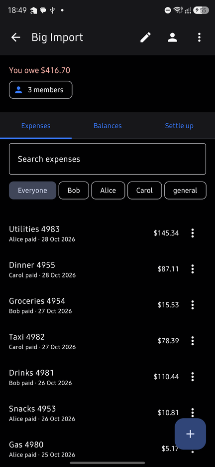
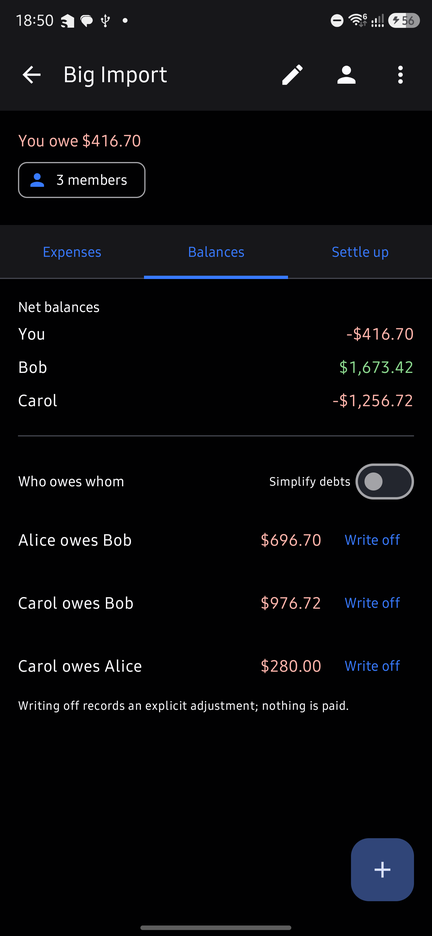
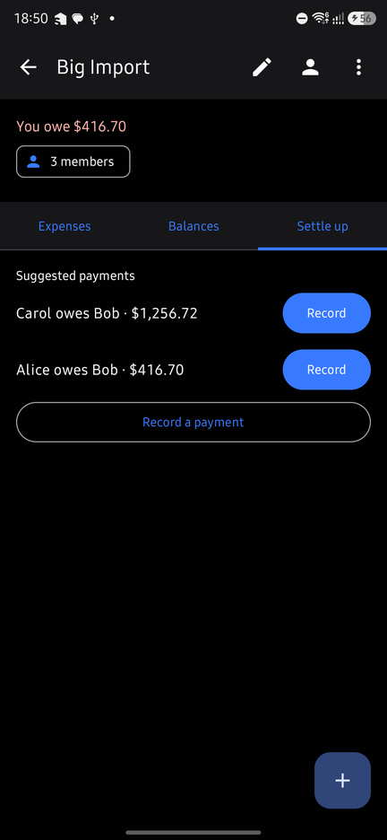
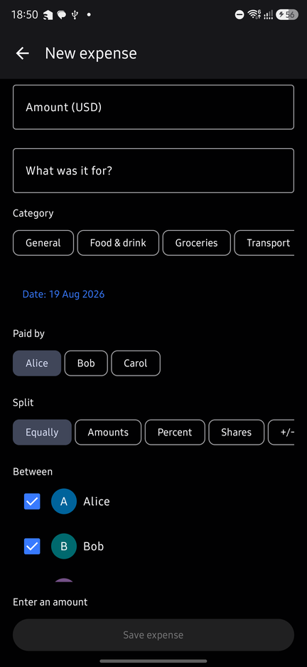
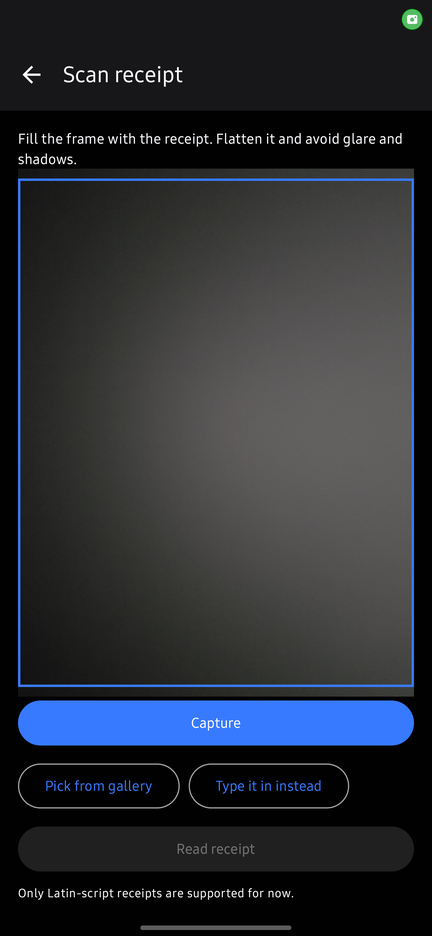
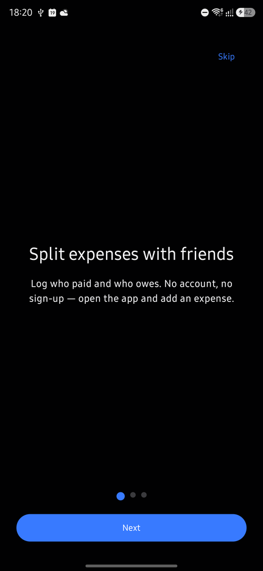

# Dibs

**Split expenses with friends. Everything stays on your phone.**

[](https://github.com/Pranjulcr7/dibs/actions/workflows/ci.yml)
[](LICENSE)

> 🚧 **Pre-release.** Everything below works on Android today and is tested,
> including sharing a group between phones with no server. There is no tagged
> release or store listing yet. [ROADMAP.md](ROADMAP.md) is the plan from here
> to 1.0, iOS, and an MCP server; [PROGRESS.md](PROGRESS.md) is the dated log.

| Expenses | Balances | Settle up |
|---|---|---|
|  |  |  |

| New expense | Scan a receipt | First run |
|---|---|---|
|  |  |  |

<sub>Captured on a Galaxy S24 Ultra, dark theme, with a 5,000-expense group
imported from Splitwise.</sub>

## Why Dibs

- **No account.** No email, no phone number, no sign-up. Open the app, add an expense.
- **No server.** Your data lives on your phone and syncs directly with your
  friends' phones when you choose to. There is nothing to shut down, breach, or subpoena.
- **No ads, no caps, no upsell.** Free and open source. Dibs collects nothing — see
  [PRIVACY.md](PRIVACY.md).

## Features

Working today:

- Groups and one-off "just this once" splits, with balances you can always drill
  into (who owes whom, not just nets)
- Six split modes: equal, exact amounts, percentages, shares, +/- adjustment, and
  itemized with proportional tax and tip — every split sums to the total exactly
- Several payers on one expense, partial settlements, write-offs, settle-up
  suggestions with an opt-in "simplify debts" view
- Search, categories, recurring-expense reminders, 30-day trash, archive
- Splitwise CSV import (with preview and duplicate protection) and CSV export
- Receipt scanning, fully on-device, with a review step before anything is
  saved. Typing the items in is always one tap away
- Sharing a group between phones with no server — see below
- Encrypted `.dibs` backups: one passphrase-protected file you can keep anywhere
- Biometric app lock, screenshot blocking — both opt-in

Not built yet (see [ROADMAP.md](ROADMAP.md)):

- A store release, translations, and an iOS app
- Sync that does not need a file handed over each time
- An MCP server, so an AI assistant can read and add expenses

## Sharing a group

There is no account and no server, so phones exchange small encrypted files
through whatever you already use — WhatsApp, Signal, email, AirDrop-style
sharing.

1. **Invite.** In the group, open *Members → Invite* and tap *Send invite*.
   That sends one file holding the invite and the group's expenses.
2. **Join.** The other person opens the file with Dibs, picks which member
   they are (or adds themselves), and taps *Join*. Standing together? They can
   scan the QR code instead.
3. **Tell the group.** Dibs asks the new member to send one file back, so the
   others see them. Nothing is ever sent automatically.
4. **Stay in step.** Whoever adds something taps *Share updates* and sends the
   file. Opening it on another phone merges it in. The group header says when
   there are changes you have not shared.

Two people can add, edit, and even delete the same expense while offline; once
the files have gone both ways, both phones show exactly the same thing. An
invite works once and lasts seven days; it can be cancelled, and a group can
require that new members are approved. Whoever holds an invite can read the
group, so send it only to the person joining. [SECURITY.md](SECURITY.md) has
the details and the limits.

## How it works

Dibs is local-first. Every change is a small immutable fact appended to a log on
your device. Syncing with friends is just exchanging encrypted copies of those
facts — merging is a set union, so devices that have seen the same facts always
agree, byte for byte, with no server to arbitrate. Money is integer minor units
end to end; splits are allocated with the largest-remainder method so every cent
is accounted for and every device computes the identical answer.

See [ARCHITECTURE.md](ARCHITECTURE.md) for the module map and the op-log design.

## Build from source

Requirements: JDK 17 and the Android SDK. Nothing else — no key generation, no
`local.properties` editing.

```bash
git clone https://github.com/Pranjulcr7/dibs.git
cd dibs
./gradlew :app:assembleDebug
```

Run the tests (the domain core needs no emulator):

```bash
./gradlew check
```

`check` also verifies [docs/requirements.yaml](docs/requirements.yaml), which
maps every requirement in the spec to the tests that cover it. To drive the
installed app end to end on two emulators, including an invite going from one
phone to the other, see [CONTRIBUTING.md](CONTRIBUTING.md).

## Contributing

See [CONTRIBUTING.md](CONTRIBUTING.md). Translations, currency edge cases, and
edge-case tests from [SPEC.md](SPEC.md) §6 are great first contributions.

This is a side project; issues and PRs are reviewed on a best-effort basis —
expect responses within a couple of days, not hours.

## License

[Apache-2.0](LICENSE)
